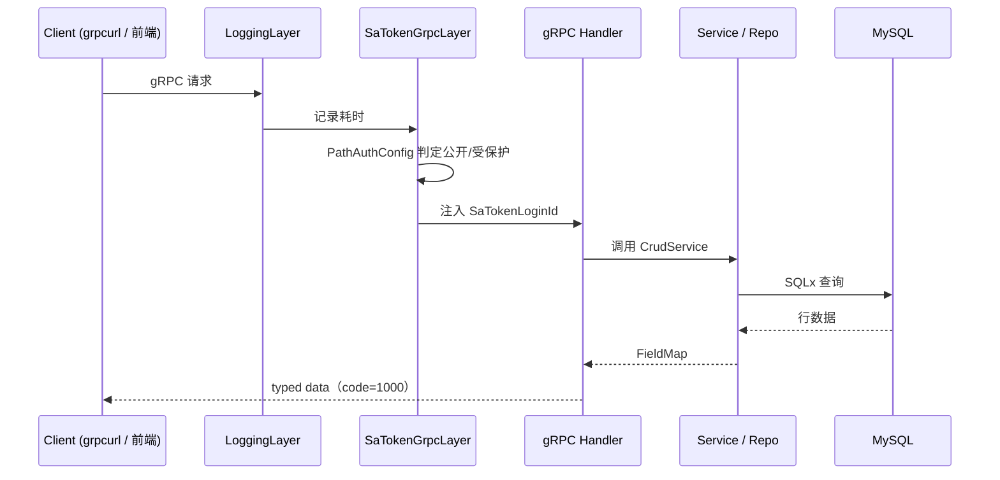
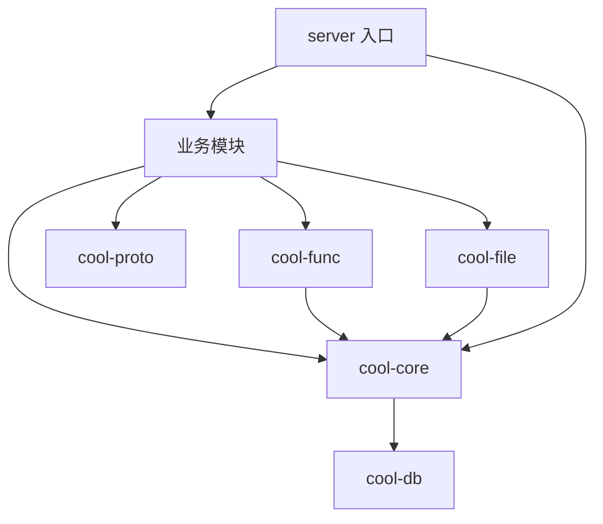

## 请求链路



## crate 分层

```text
cool-admin-rust/
├── proto/                  # .proto 契约（单一事实来源）
├── crates/
│   ├── cool-proto/         # proto 生成代码 + Reflection descriptor
│   ├── cool-core/          # 核心框架
│   │   ├── crud.rs         #   CrudService trait
│   │   ├── repo.rs         #   CrudRepo（通用 CRUD）
│   │   ├── model.rs        #   Model trait / 列白名单
│   │   ├── query.rs        #   排序白名单 / WHERE 构造
│   │   ├── satoken.rs      #   sa-token 集成
│   │   ├── password.rs     #   argon2 + 旧 MD5 升级
│   │   ├── cache.rs        #   Mem / Redis 缓存
│   │   └── eps.rs          #   接口权限元数据
│   ├── cool-db/            # SQLx 连接池 + 迁移
│   ├── cool-func/          # 分布式函数（Redis pub/sub）
│   ├── cool-file/          # 文件存储驱动（local/minio/oss）
│   ├── modules/
│   │   ├── base/           # 用户/角色/部门/菜单/日志/登录
│   │   ├── demo/           # CRUD 示范
│   │   ├── dict/           # 字典
│   │   ├── space/          # 文件空间
│   │   └── task/           # 定时任务
│   ├── cool-tools/         # CLI 脚手架
│   └── server/             # gRPC 入口
├── migrations/             # SQLx 迁移
└── manifest/config/        # 配置
```

## 分层依赖

依赖方向严格自上而下，禁止反向依赖：



## 部署形态

| 模式 | 说明 |
| --- | --- |
| 单体 | `cool-admin-rust` 一个进程承载全部模块（开发友好） |
| 微服务 | `base/dict/space/task` 各自独立进程，sa-token 分布式会话共享登录态 |

详见 [微服务架构](/guides/microservices)。

## 模块内部结构

每个业务模块遵循统一的三层模式（对齐 cool-admin-go）：

```text
crates/modules/<name>/
├── src/
│   ├── model/        # Model 实现（表名 + 列元信息）
│   ├── service/      # CrudService 实现 + 业务钩子
│   └── handler/      # gRPC Service 实现
└── tests/            # 集成测试
```

<Tip>
  新增模块可用 `cool-tools module <name>` 一键生成骨架。
</Tip>
