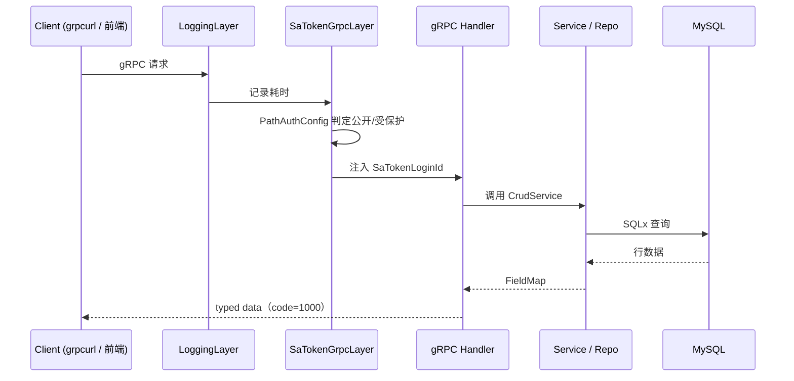
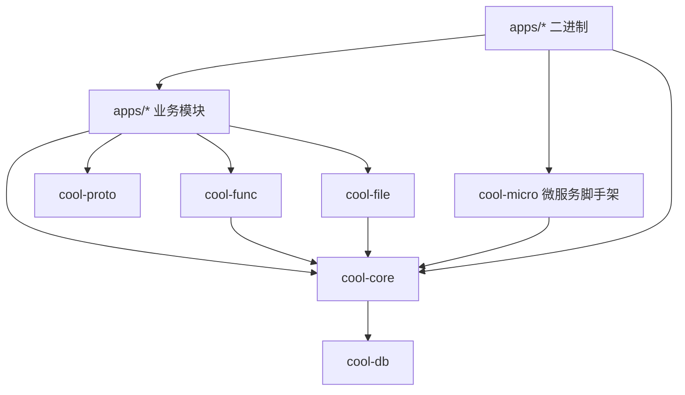

## 请求链路



## crate 分层

```text
cool-admin-rust/
├── proto/                  # 共享契约（common.v1 / internal.v1）
├── crates/                 # 基础库（可复用）
│   ├── cool-proto/         #   proto 代码生成（聚合各 app 自有 proto）
│   ├── cool-core/          #   核心框架（CRUD / sa-token / 缓存 / 密码）
│   ├── cool-db/            #   SQLx 连接池
│   ├── cool-func/          #   分布式函数（Redis pub/sub）
│   ├── cool-file/          #   文件存储驱动
│   ├── cool-micro/         #   微服务脚手架（分布式会话 / 服务鉴权）
│   └── cool-tools/         #   CLI
├── apps/                   # 业务应用（模块 + 微服务 + proto + manifest + migrations）
│   ├── base/               #   登录 / 用户 / 角色 / 部门 / 菜单 / 日志  :8001
│   │   ├── proto/base/v1/  #     自有 gRPC 契约
│   │   ├── manifest/       #     自有配置 config.yaml
│   │   ├── migrations/     #     自有数据库迁移
│   │   └── src/            #     lib（业务） + main（微服务入口）
│   ├── dict/               #   字典  :8002
│   ├── space/              #   文件空间  :8003
│   ├── task/               #   定时任务  :8004
│   ├── demo/               #   CRUD 示范（仅 lib）
│   └── server/             #   单体 all-in-one
└── docs/                   # Mintlify 文档
```

## 分层依赖

依赖方向严格自上而下，禁止反向依赖：



## 部署形态

| 模式 | 说明 |
| --- | --- |
| 单体 | `cool-admin-rust` 一个进程承载全部模块（开发友好） |
| 微服务 | `base/dict/space/task` 各自独立进程，sa-token 分布式会话共享登录态 |

详见 [微服务架构](/guides/microservices)。

## 应用内部结构

每个应用完全自包含（对齐 cool-admin-go 三层模式 + 微服务自治）：

```text
apps/<name>/
├── proto/<pkg>/v1/   # 自有 gRPC 契约
├── manifest/         # 自有配置 config.yaml
├── migrations/       # 自有数据库迁移（版本号全局唯一）
├── src/
│   ├── lib.rs        # 业务模块（Model / Service / Handler）
│   ├── main.rs       # 微服务入口（lib + bin 双目标）
│   ├── model/
│   ├── service/
│   └── handler/
└── tests/            # 集成测试
```

<Note>
  迁移版本号分段管理（base=10xx / demo=20xx / dict=30xx / space=40xx / task=50xx），
  配合 `ignore_missing` 实现多应用共享数据库的平滑升级。
  详见 [数据库迁移](/guides/migrations)。
</Note>

<Tip>
  新增模块可用 `cool-tools module <name>` 一键生成骨架。
</Tip>
