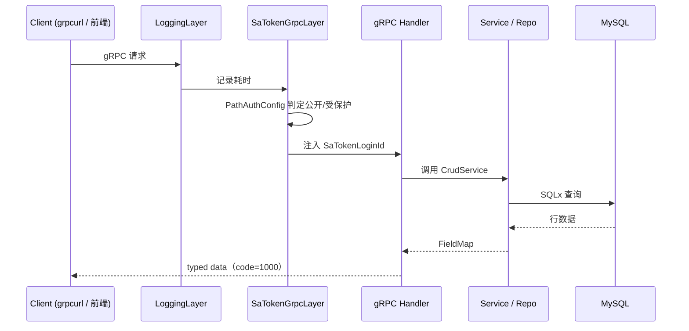
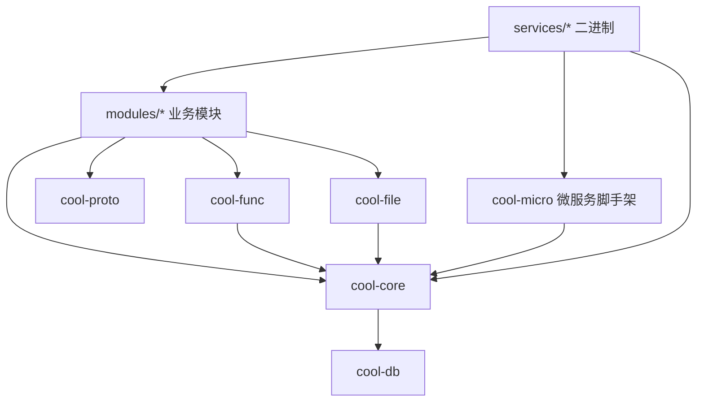

## 请求链路



## crate 分层

```text
cool-admin-rust/
├── proto/                  # .proto 契约（单一事实来源）
├── crates/                 # 基础库（可复用）
│   ├── cool-proto/         #   proto 生成代码 + Reflection descriptor
│   ├── cool-core/          #   核心框架（CRUD / sa-token / 缓存 / 密码）
│   ├── cool-db/            #   SQLx 连接池 + 迁移
│   ├── cool-func/          #   分布式函数（Redis pub/sub）
│   ├── cool-file/          #   文件存储驱动（local/minio/oss）
│   ├── cool-micro/         #   微服务脚手架（分布式会话 / 服务鉴权）
│   └── cool-tools/         #   CLI 脚手架
├── modules/                # 业务模块（被 services 引用）
│   ├── base/               #   登录 / 用户 / 角色 / 部门 / 菜单 / 日志
│   ├── demo/               #   CRUD 示范
│   ├── dict/               #   字典
│   ├── space/              #   文件空间
│   └── task/               #   定时任务
├── services/               # 可执行服务（独立部署）
│   ├── server/             #   单体 all-in-one（开发友好）
│   ├── base-service/       #   base 微服务 :8001
│   ├── dict-service/       #   dict 微服务 :8002
│   ├── space-service/      #   space 微服务 :8003
│   └── task-service/       #   task 微服务 :8004
├── migrations/             # SQLx 迁移
├── manifest/config/        # 配置（config.yaml / micro-*.yaml）
└── docs/                   # Mintlify 文档
```

## 分层依赖

依赖方向严格自上而下，禁止反向依赖：



## 部署形态

| 模式 | 说明 |
| --- | --- |
| 单体 | `cool-admin-rust` 一个进程承载全部模块（开发友好） |
| 微服务 | `base/dict/space/task` 各自独立进程，sa-token 分布式会话共享登录态 |

详见 [微服务架构](/guides/microservices)。

## 模块内部结构

每个业务模块遵循统一的三层模式（对齐 cool-admin-go）：

```text
crates/modules/<name>/
├── src/
│   ├── model/        # Model 实现（表名 + 列元信息）
│   ├── service/      # CrudService 实现 + 业务钩子
│   └── handler/      # gRPC Service 实现
└── tests/            # 集成测试
```

<Tip>
  新增模块可用 `cool-tools module <name>` 一键生成骨架。
</Tip>
