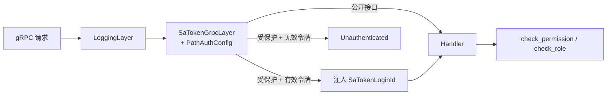
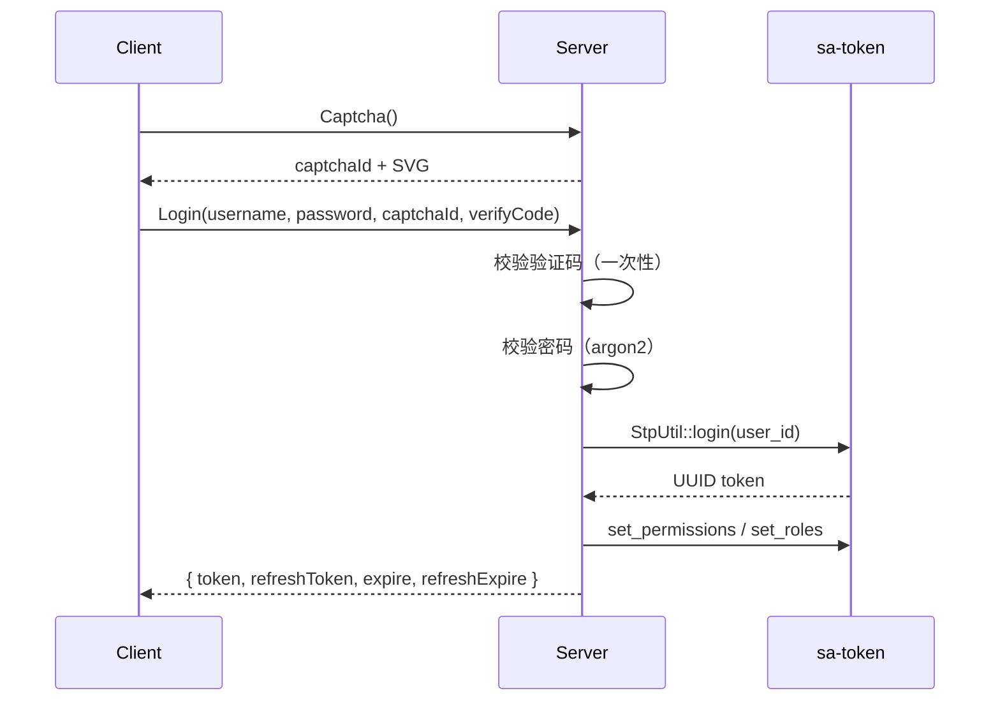

登录与权限由 [sa-token-rust](https://github.com/sa-tokens/sa-token-rust) 的
`sa-token-plugin-tonic` 承担。

## 架构



## Token 读取优先级

| 优先级 | Header 名称 | 支持格式 |
| --- | --- | --- |
| 1 | `satoken` | `Bearer xxx` 或直接 `xxx` |
| 2 | `authorization` | `Bearer xxx` |
| 3 | `Authorization` | `Bearer xxx` |

<CodeGroup>
```bash authorization
grpcurl -H "authorization: Bearer <token>" ...
```

```bash satoken
grpcurl -H "satoken: <token>" ...
```
</CodeGroup>

## 路径鉴权规则（PathAuthConfig）

Ant 风格匹配，gRPC URI path 格式为 `/<package>.<Service>/<Method>`：

```rust
// cool-core/src/satoken.rs
pub fn default_path_config() -> PathAuthConfig {
    PathAuthConfig::new()
        .include(vec![
            "/base.v1.**".to_string(),
            "/demo.v1.**".to_string(),
            "/dict.v1.**".to_string(),
            "/space.v1.**".to_string(),
            "/task.v1.**".to_string(),
        ])
        .exclude(vec![
            "/base.v1.BaseOpenService/Captcha".to_string(),
            "/base.v1.BaseOpenService/Login".to_string(),
            "/base.v1.BaseOpenService/RefreshToken".to_string(),
            "/internal.v1.InternalService/**".to_string(),
        ])
}
```

## 登录流程



### 关键安全项

<AccordionGroup>
  <Accordion title="验证码一次性">
    验证码校验成功后立即作废，防止重放爆破。5 分钟过期。
  </Accordion>
  <Accordion title="登录失败锁定">
    同账号 10 分钟内失败 5 次临时锁定，防口令爆破。
  </Accordion>
  <Accordion title="统一错误提示">
    密码错误返回「账户或密码不正确」，防用户名枚举。
  </Accordion>
  <Accordion title="改密后旧 token 失效">
    `passwordV` 递增，refreshToken 立即失效，需重新登录。
  </Accordion>
  <Accordion title="argon2 + 旧哈希升级">
    新密码使用 argon2；存量 MD5 哈希登录成功后自动升级为 argon2。
  </Accordion>
</AccordionGroup>

## 权限 / 角色

登录时按角色写入菜单权限标识：

```rust
// 登录成功后
let perms = perms_for_roles(&role_ids).await;  // menu.perms
satoken::set_permissions(&login_id, perms).await?;
satoken::set_roles(&login_id, role_ids).await?;
```

handler 内按需校验：

```rust
use cool_core::satoken::{has_permission, has_role, login_id_from_request};

async fn handler(req: Request<T>) -> Result<Response<T>, Status> {
    let uid = login_id_from_request(&req)
        .ok_or_else(|| Status::unauthenticated("未登录"))?;

    if !has_permission(&uid, "user:list").await {
        return Err(Status::permission_denied("无权限"));
    }
    // ...
}
```

## 会话管理

| 操作 | API |
| --- | --- |
| 登录 | `satoken::login(user_id)` |
| 登出当前 | `satoken::logout(token)` |
| 登出全部会话 | `satoken::logout_by_login_id(user_id)` |
| 取登录 ID | `login_id_from_request(&req)` |

<Warning>
  refreshToken 是前端契约字段，由服务端缓存管理（登出 / 改密立即失效），不参与 sa-token 会话本身。
</Warning>
