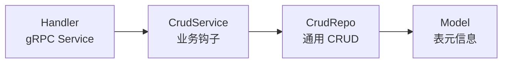

CoolAdminRust 内置通用 CRUD 引擎：定义好 **Model** 与 **Service**，即自动获得
`Add / Delete / Update / Info / List / Page` 六个标准接口。

## 三层抽象



| 层 | 职责 | 对应 Go |
| --- | --- | --- |
| `Model` | 表名 + 列元信息（可写/可过滤白名单） | `cool/model.go` |
| `CrudRepo` | Add/Delete/Update/Info/List/Page | `cool/service.go` |
| `CrudService` | 业务钩子 `modify_before/after` | `IService` |

## 定义 Model

```rust
use cool_core::model::{ColumnMeta, Model};

pub struct DemoSample;

const COLS: &[ColumnMeta] = &[
    ColumnMeta::read("id"),
    ColumnMeta::rw("name"),
    ColumnMeta::rw("remark"),
    ColumnMeta::computed("createTime"),
    ColumnMeta::computed("updateTime"),
    ColumnMeta::computed("deleteTime"),
];

impl Model for DemoSample {
    fn table_name() -> &'static str { "demo_sample" }
    fn columns() -> &'static [ColumnMeta] { COLS }
}
```

<Note>
  `ColumnMeta::rw` 可读写、`read` 只读、`computed` 系统字段（不可写）。
  列白名单可防 SQL 注入 —— 非法字段直接拒绝。
</Note>

## 定义 Service

```rust
pub struct DemoSampleService {
    repo: CrudRepo<DemoSample>,
}

pub fn new(pool: MySqlPool) -> DemoSampleService {
    let config = CrudConfig {
        unique_key: {
            let mut m = HashMap::new();
            m.insert("name".into(), "名称已存在".into());
            m
        },
        not_null_key: {
            let mut m = HashMap::new();
            m.insert("name".into(), "名称不能为空".into());
            m
        },
        list_query_op: QueryOp {
            key_word_field: vec!["name".into(), "remark".into()],
            ..Default::default()
        },
        ..Default::default()
    };
    DemoSampleService {
        repo: CrudRepo::<DemoSample>::new(pool, config),
    }
}

#[async_trait::async_trait]
impl CrudService for DemoSampleService {
    type Model = DemoSample;
    fn repo(&self) -> &CrudRepo<Self::Model> { &self.repo }

    async fn modify_after(&self, method: &str, _data: &FieldMap) -> CoolResult<()> {
        tracing::info!(%method, "after hook");
        Ok(())
    }
}
```

## 开箱即用能力

<AccordionGroup>
  <Accordion title="软删除">
    查询自动过滤 `deleteTime IS NULL`；`Delete` = `UPDATE deleteTime = NOW(3)`。
  </Accordion>
  <Accordion title="唯一键 / 非空键">
    `UniqueKey` / `NotNullKey` 在 Add/Update 时校验，错误提示可配置。
  </Accordion>
  <Accordion title="排序白名单（防注入）">
    `safe_order_by` 对齐 Go 正则 `^[A-Za-z0-9_.]+(,[A-Za-z0-9_.]+)*$`，
    `id; DROP TABLE` 等注入直接忽略。
  </Accordion>
  <Accordion title="分页 / 导出上限">
    `page/size` 分页；`isExport + maxExportLimit` 控制导出条数。
  </Accordion>
  <Accordion title="模糊搜索 + 等值过滤">
    `key_word_field` 模糊匹配；`field_eq` 等值过滤（自动白名单）。
  </Accordion>
</AccordionGroup>

## QueryInput

```rust
pub struct QueryInput {
    pub keyword: Option<String>,   // 模糊搜索
    pub eq: EqMap,                 // 等值过滤
    pub order: Option<String>,     // 排序字段
    pub sort: Option<String>,      // asc | desc
    pub page: i64,
    pub size: i64,
    pub is_export: bool,
    pub max_export_limit: i64,
}
```

## 六个标准接口

| RPC | 说明 |
| --- | --- |
| `Add` | 新增（校验唯一键 / 非空键 / 列白名单） |
| `Delete` | 批量软删除 `ids[]` |
| `Update` | 按 id 局部更新 |
| `Info` | 详情（可忽略敏感字段） |
| `List` | 列表（keyword + eq + 排序） |
| `Page` | 分页（total + list） |
