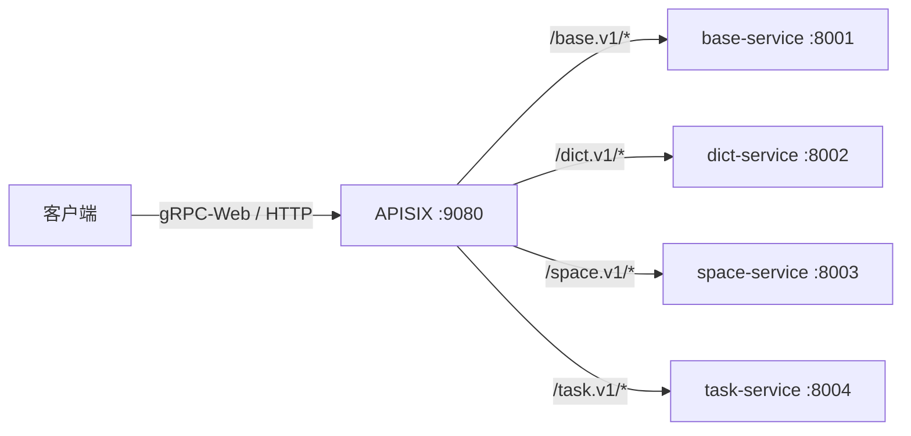
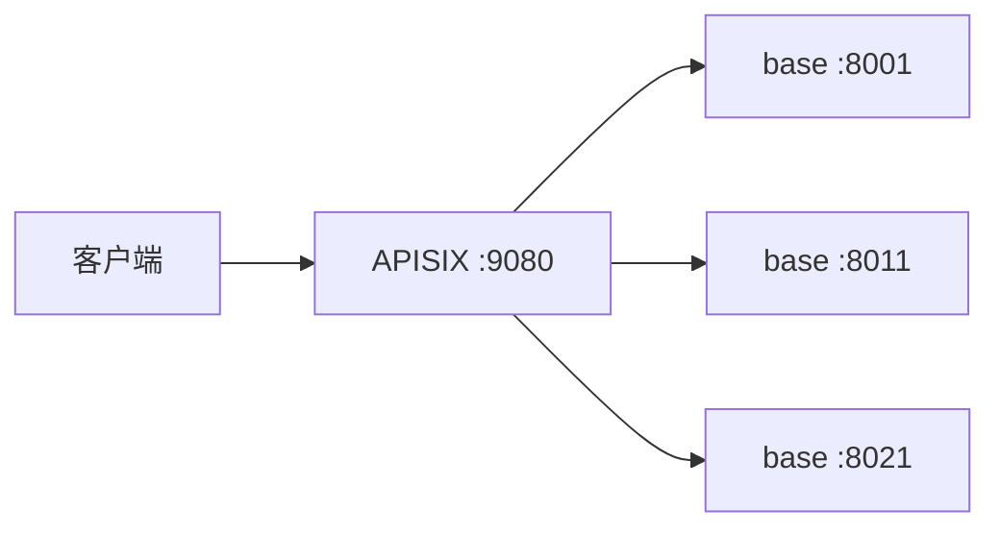

`cool-apisix` 提供 **APISIX 网关路由自动注册** —— 微服务启动时把自己的 gRPC 路由注册到
[Apache APISIX](https://apisix.apache.org/zh/)，网关统一对外暴露。

<Note>
  **按需引入**：只有依赖 `cool-apisix` 的微服务才会注册路由；未引入的服务不会有任何副作用。
</Note>

## 架构



## 快速开始

### 1. 引入依赖

```toml
# apps/<name>/Cargo.toml
[dependencies]
cool-apisix = { workspace = true }
```

### 2. 启动时注册

```rust
// apps/<name>/src/main.rs
if let Err(e) = cool_apisix::auto_register(
    &cool_apisix::ApisixConfig::load(),
    "base-service",     // 服务 ID（路由资源 ID 前缀）
    "base.v1",          // proto 包名（匹配 /base.v1/*）
    8001,               // 监听端口
).await {
    tracing::warn!("apisix route register failed: {e}");
}
```

### 3. 配置

`apps/<name>/manifest/config.yaml`：

```yaml
apisix:
  enabled: true                              # 显式开启才注册
  adminUrl: "http://127.0.0.1:9180"          # Admin API 地址
  adminKey: "edd1c9f034335f136f87ad84b625c8f1"
  upstreamHost: "127.0.0.1"                  # 本服务对外可达地址
  scheme: "grpc"                             # gRPC 代理
  prefix: "cool"                             # 路由 ID 前缀
```

或用环境变量：

```bash
export APISIX_ADMIN_URL=http://127.0.0.1:9180
export APISIX_ADMIN_KEY=your-admin-key
export APISIX_ENABLED=true
```

## API

<AccordionGroup>
  <Accordion title="auto_register(cfg, service_id, package, port)">
    **推荐入口**。自动构造路由：ID = `{prefix}-{service_id}`，
    URI = `/{package}/*`，上游 = `{upstream_host}:{port}`。

    ```rust
    cool_apisix::auto_register(&cfg, "dict-service", "dict.v1", 8002).await?;
    ```
  </Accordion>

  <Accordion title="register_routes(cfg, routes)">
    批量注册自定义路由（PUT 幂等 upsert）。

    ```rust
    let route = cool_apisix::ServiceRoute {
        id: "custom-route".into(),
        name: "自定义路由".into(),
        uris: vec!["/my.api.v1/*".into()],
        upstream_addr: "10.0.0.5:9000".into(),
        scheme: "grpc".into(),
        priority: 10,
        labels: Default::default(),
    };
    cool_apisix::register_routes(&cfg, &[route]).await?;
    ```
  </Accordion>

  <Accordion title="deregister_route(cfg, route_id)">
    删除路由（服务下线时调用）。

    ```rust
    cool_apisix::deregister_route(&cfg, "cool-base-service").await?;
    ```
  </Accordion>
</AccordionGroup>

## APISIX Admin API 说明

| 项目 | 值 |
| --- | --- |
| 默认地址 | `http://127.0.0.1:9180/apisix/admin` |
| 认证 | `X-API-KEY: {admin_key}` |
| 注册方式 | `PUT /apisix/admin/routes/{id}`（幂等 upsert） |
| 路由匹配 | `uris: ["/package/*"]`（Ant 风格） |
| gRPC 代理 | `upstream.scheme: "grpc"` |

<Warning>
  APISIX 3.19 校验：`uri` 与 `uris` **二选一**，不能同时出现。本 crate 只写 `uris`。
</Warning>

## Docker Compose 一键启动

```bash
docker compose up -d etcd apisix apisix-dashboard
```

| 服务 | 端口 | 说明 |
| --- | --- | --- |
| `cool-rust-etcd` | 2379 | APISIX 配置中心 |
| `cool-rust-apisix` | 9080 / 9180 / 9443 | 网关 / Admin API / HTTPS |
| `cool-rust-apisix-dashboard` | 9000 | 可视化管理 UI |

Dashboard 访问：http://localhost:9000 （默认 `admin / admin`）

配置文件：`deploy/apisix.yaml`、`deploy/apisix-dashboard.yaml`

## 本地验证（APISIX 3.19.0）

```bash
# 启动 etcd + APISIX
docker run -d --name cool-etcd --network cool-net quay.io/coreos/etcd:v3.5.13 \
  /usr/local/bin/etcd --advertise-client-urls http://cool-etcd:2379 \
  --listen-client-urls http://0.0.0.0:2379

docker run -d --name cool-apisix --network cool-net -p 9080:9080 -p 9180:9180 \
  -v deploy/apisix.yaml:/usr/local/apisix/conf/config.yaml \
  swr.cn-north-4.myhuaweicloud.com/ddn-k8s/docker.io/apache/apisix:3.19.0-debian

# 注册路由
cargo run -p cool-apisix --example register_real

# 查看
curl http://127.0.0.1:9180/apisix/admin/routes \
  -H "X-API-KEY: edd1c9f034335f136f87ad84b625c8f1"
```

实测输出：

```json
{
  "total": 2,
  "list": [
    { "id": "cool-base-service",  "uris": ["/base.v1/*"],  "upstream": {"nodes": {"127.0.0.1:8001": 1}, "scheme": "grpc"} },
    { "id": "cool-space-service", "uris": ["/space.v1/*"], "upstream": {"nodes": {"127.0.0.1:8003": 1}, "scheme": "grpc"} }
  ]
}
```

## 配置文件示例

`deploy/apisix.yaml`：

```yaml
apisix:
  node_listen: 9080
  enable_admin: true

deployment:
  role: traditional
  role_traditional:
    config_provider: etcd
  etcd:
    host:
      - "http://cool-etcd:2379"
    prefix: "/apisix"
  admin:
    admin_key:
      - name: admin
        key: edd1c9f034335f136f87ad84b625c8f1
        role: admin
    allow_admin:
      - 0.0.0.0/0
    admin_listen:
      ip: 0.0.0.0
      port: 9180

plugins:
  - prometheus
  - grpc-transcode
  - grpc-web
  - proxy-rewrite
```

## 多实例自动发现

同一服务启动多个实例时，APISIX **自动合并上游节点**，无需手工配置负载均衡：



```bash
# 实例 1
MICRO_CONFIG=apps/base/manifest/config.yaml ./target/debug/base-service  # :8001
# 实例 2（不同端口）
MICRO_CONFIG=apps/base/manifest/config.yaml   MICRO_SERVER__ADDRESS=0.0.0.0:8011 ./target/debug/base-service
# 实例 3
MICRO_CONFIG=apps/base/manifest/config.yaml   MICRO_SERVER__ADDRESS=0.0.0.0:8021 ./target/debug/base-service
```

**节点管理**：

| 操作 | 行为 |
| --- | --- |
| 实例启动 | GET 现有节点 → 合并自己 → PUT（幂等） |
| 实例下线 | 摘除自己的节点；若已无实例则删除路由 |

```rust
// 多实例注册（推荐）
let inst = cool_apisix::ServiceInstance {
    service_id: "base-service".into(),
    package: "base.v1".into(),
    addr: "host.docker.internal:8001".into(),
};
cool_apisix::register_instance(&cfg, &inst).await?;

// 实例下线时摘除
cool_apisix::deregister_instance(&cfg, &inst).await?;
```

实测（3 实例注册后摘除 1 个）：

```json
{
  "nodes": {
    "host.docker.internal:8021": 1,
    "host.docker.internal:8001": 1
  }
}
```

## 故障转移与健康检查

上游自动配置 **retries + 主动/被动健康检查**，实例宕机时请求自动切换：

```yaml
upstream:
  type: roundrobin
  retries: 2                    # 失败自动重试到其他节点
  checks:
    active:                     # TCP 主动探测（2s 间隔）
      type: tcp
      healthy:   { interval: 2, successes: 1 }
      unhealthy: { interval: 1, failures: 2 }
    passive:                    # 被动探测（基于请求失败）
      healthy:   { successes: 3 }
      unhealthy: { http_failures: 2, tcp_failures: 2 }
```

### 实测：异常宕机（kill -9 不摘除节点）

```text
kill -9 :8012（无 deregister，APISIX 节点表仍含死节点）

立即压测 20 次    → 20/20 成功 ✅（retries 立即兜底）
健康检查收敛后 20 次 → 20/20 成功 ✅（死节点已隔离）
流量分布          → :8002 → 21  :8022 → 19
```

### 两种下线方式对比

| 方式 | 行为 | 结果 |
| --- | --- | --- |
| **优雅下线** | `deregister_instance` → 进程退出 | 节点立即摘除，100% 成功 |
| **异常宕机** | `kill -9`（无摘除） | retries 兜底 + 健康检查隔离，100% 成功 |

<Note>
  优雅下线推荐在进程退出钩子中调用 `deregister_instance`；
  即使遗漏，健康检查 + retries 也能保证零失败。
</Note>

## gRPC 与 gRPC-Web 双路由

原生 gRPC 与浏览器 gRPC-Web **分离注册**（避免 grpc-web 插件干扰原生 HTTP/2）：

| 协议 | URI 模式 | 插件 | 用途 |
| --- | --- | --- | --- |
| 原生 gRPC | `/base.v1.*` | proxy-rewrite | grpcurl / 服务间调用 |
| gRPC-Web | `/web/base.v1.*` | proxy-rewrite + grpc-web | 浏览器前端 |

gRPC-Web 路由通过 `regex_uri: ["/web/(.*)", "/$1"]` 剥离前缀后转发。

```bash
# 原生 gRPC
grpcurl -plaintext localhost:9080 base.v1.BaseOpenService/Captcha

# gRPC-Web（浏览器）
curl -X POST http://localhost:9080/web/base.v1.BaseOpenService/Captcha \
  -H "Content-Type: application/grpc-web+proto" -H "X-Grpc-Web: 1"
```

## 设计要点

| 特性 | 说明 |
| --- | --- |
| **按需引入** | 未依赖 `cool-apisix` 的服务零副作用 |
| **幂等 upsert** | PUT 重复执行安全，服务重启自动刷新路由 |
| **gRPC 代理** | `scheme: grpc` + `/package/*` 匹配全部 RPC |
| **失败不阻断** | 注册失败仅告警，服务照常启动 |
| **标签管理** | `managed-by: cool-apisix` 便于批量运维 |
| **双协议路由** | 原生 gRPC + gRPC-Web 分离，`/web/` 前缀 + 路径重写 |
| **多实例自动发现** | 节点合并/摘除，APISIX roundrobin 天然负载均衡 |
| **自动故障转移** | retries + 主动/被动健康检查，宕机零失败 |

<Note>
  生产环境务必更换默认 Admin Key，并限制 `allow_admin` IP 白名单。
</Note>

## 测试

```bash
cargo test -p cool-apisix
# 7 项：路由报文构造、URL 拼接、禁用跳过、mock Admin API 集成
```
