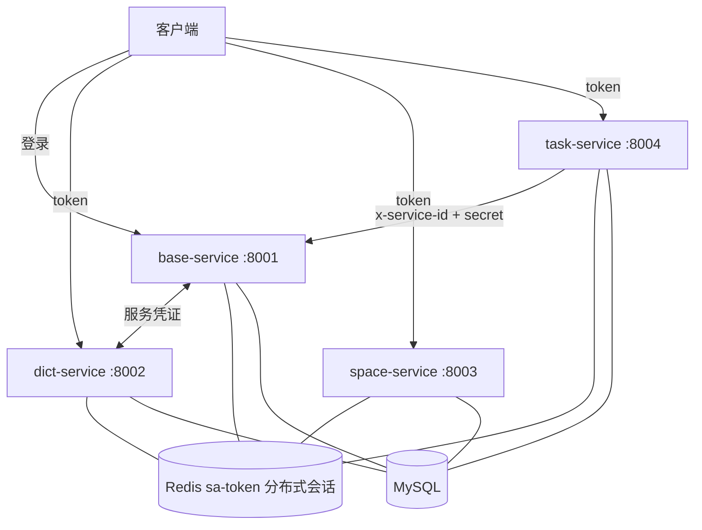
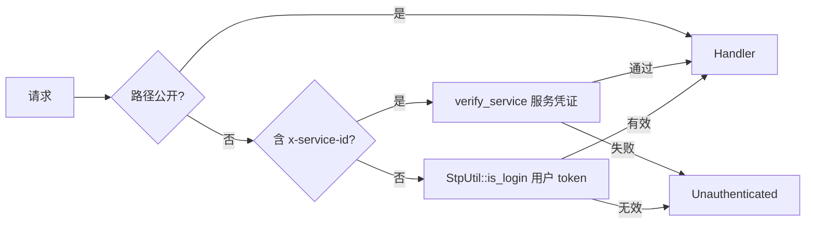

## 架构模式

`base` / `dict` / `space` / `task` 可作为**独立 gRPC 微服务**分别启动，
通过 sa-token **分布式会话**共享登录态与服务凭证。



## 服务端口

| 服务 | 端口 | 职责 |
| --- | --- | --- |
| `base-service` | 8001 | 登录 / 用户 / 角色 / 部门 / 菜单 / 日志 / 文件 / EPS |
| `dict-service` | 8002 | 字典类型 / 条目 |
| `space-service` | 8003 | 文件空间分类 / 索引 |
| `task-service` | 8004 | 定时任务调度 |

## 分布式会话（sa-token）

所有服务共享同一 Redis 存储（相同 `key_prefix`），核心收益：

<CardGroup cols={2}>
  <Card title="跨服务单点登录" icon="key">
    在 base-service 登录获得的 token，可直接访问 dict/space/task 任意服务。
  </Card>
  <Card title="服务凭证" icon="shield">
    服务间调用使用 `x-service-id` + `x-service-secret`，无需用户 token。
  </Card>
</CardGroup>

### 初始化

```rust
// crates/cool-micro/src/session.rs
use sa_token_core::{DistributedSessionManager, SaStorageDistributedStorage, ServiceCredential};

// 1) 共享 Redis 存储
let storage = RedisStorage::from_config(redis_cfg, "sa:").await?;
let state = SaTokenState::builder()
    .storage(Arc::new(storage))
    .timeout(3600)
    .build();

// 2) 分布式会话管理器（服务凭证 + 共享属性）
let dsm = DistributedSessionManager::new(
    Arc::new(SaStorageDistributedStorage::new(storage, "sa:")),
    "base-service".into(),
    Duration::from_secs(3600),
);

// 3) 注册服务凭证
dsm.register_service(ServiceCredential {
    service_id: "base-service".into(),
    service_name: "base".into(),
    secret_key: "micro-secret-base-001".into(),
    created_at: Utc::now(),
    permissions: vec![],
}).await?;
```

### 鉴权链路



## 目录布局

```text
apps/            # 业务应用（每个微服务自包含）
├── base/        # proto/ + manifest/ + migrations/ + src(lib+bin)
├── dict/        # 同上
├── space/
├── task/
├── demo/        # 仅 lib（示范模块）
└── server/      # 单体 all-in-one
crates/          # 基础库：cool-proto / cool-core / cool-db / cool-func / cool-file / cool-micro
proto/           # 共享契约：common.v1 / internal.v1
```

<Note>
  每个应用自带 **proto** / **manifest** / **migrations** —— 微服务完全自包含，可独立演进与部署。
  `proto/common` 为跨服务共享契约，由 `cool-proto` 统一生成代码。
</Note>

## 启动各服务

<CodeGroup>
```bash base-service
MICRO_CONFIG=apps/base/manifest/config.yaml ./target/debug/base-service
```

```bash dict-service
MICRO_CONFIG=apps/dict/manifest/config.yaml ./target/debug/dict-service
```

```bash space-service
MICRO_CONFIG=apps/space/manifest/config.yaml ./target/debug/space-service
```

```bash task-service
MICRO_CONFIG=apps/task/manifest/config.yaml ./target/debug/task-service
```

<Note>
  不传 `MICRO_CONFIG` 时默认读取 `manifest/config/micro.yaml`；
  各应用推荐将配置置于 `apps/<name>/manifest/config.yaml` 并通过环境变量指定。
</Note>
</CodeGroup>

## 配置文件

每个服务一份配置，关键差异是 `service.id` / `service.secret` / `server.address`：

```yaml
service:
  id: "dict-service"
  name: "dict"
  secret: "micro-secret-dict-001"

server:
  address: "0.0.0.0:8002"

sa_token:
  timeout: 3600
  key_prefix: "sa:"        # 多服务必须一致
  enable: true

redis:
  address: "127.0.0.1:6379" # 分布式会话依赖
```

## 跨服务调用示例

```bash
# 1) base 登录拿 token
TOKEN=$(grpcurl -plaintext -d '{"username":"admin","password":"123456",...}' \
  localhost:8001 base.v1.BaseOpenService/Login | grep token)

# 2) 用同一 token 调 dict（分布式会话）
grpcurl -H "authorization: Bearer $TOKEN" \
  -d '{"types":["type"]}' localhost:8002 dict.v1.DictInfoService/Data

# 3) 服务间调用（无需用户 token）
grpcurl -H "x-service-id: task-service" -H "x-service-secret: micro-secret-task-001" \
  -d '{"page":1,"size":10}' localhost:8001 base.v1.BaseSysUserService/Page
```

## 与单体模式的关系

| 模式 | 二进制 | 适用场景 |
| --- | --- | --- |
| 单体 | `services/server` → `cool-admin-rust` | 开发 / 小规模部署（全部模块一个进程） |
| 微服务 | `services/*-service` 4 个 | 生产 / 独立扩缩容 / 故障隔离 |

两种模式共享同一套 `modules/*` 业务代码与 sa-token 鉴权实现。

<Note>
  微服务模式下 Redis 为**必需**（分布式会话依赖）；单体模式 Redis 可选（回退内存）。
</Note>
