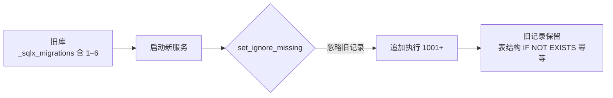

## 归属原则

每个应用**自带** `migrations/` 目录，版本号全局唯一：

| 应用 | 版本前缀 | 文件 |
| --- | --- | --- |
| `apps/base` | 1001–1099 | `1001_base_sys.sql`, `1002_base_sys_conf.sql` |
| `apps/demo` | 2001–2099 | `2001_demo_sample.sql` |
| `apps/dict` | 3001–3099 | `3001_dict.sql` |
| `apps/space` | 4001–4099 | `4001_space.sql` |
| `apps/task` | 5001–5099 | `5001_task.sql` |

<Note>
  版本号前缀按应用分段（base=10xx / demo=20xx / dict=30xx / space=40xx / task=50xx），
  避免多应用共用 `_sqlx_migrations` 表时版本冲突。
</Note>

## 执行时机

各应用启动时执行**自己的**迁移：

```rust
// apps/<name>/src/lib.rs
pub async fn migrate(pool: &sqlx::MySqlPool) -> CoolResult<()> {
    let mut migrator = sqlx::migrate::Migrator::new(migrations_dir()).await?;
    // 关键：允许多应用 migrator 共存
    migrator.set_ignore_missing(true);
    migrator.run(pool).await?;
    Ok(())
}
```

微服务启动：

```bash
MICRO_CONFIG=apps/base/manifest/config.yaml ./target/debug/base-service
# 日志: migrate: migrations done module="base"
```

单体启动会依次执行全部应用迁移。

## 平滑升级

### 版本号迁移（旧 0001–0006 → 新 1001+）

历史版本（全局 `migrations/`，版本 1–6）拆分为各应用自有迁移后，
**已有数据库无需手动清理**，升级过程如下：



实测验证：

```text
升级前 _sqlx_migrations:  1,2,3,4,5,6
启动 base-service 后:     1,2,3,4,5,6,1001,1002   ← 旧记录保留、新记录追加
日志: migrate: migrations done module="base"       ← 无报错
```

<Warning>
  表结构使用 `CREATE TABLE IF NOT EXISTS`、种子数据使用 `WHERE NOT EXISTS`，
  因此重复执行**幂等安全**，不会覆盖已有数据。
</Warning>

### 为何 `ignore_missing`

`_sqlx_migrations` 是**全局共享表**。若应用 A 的 Migrator 只认识自己的迁移，
看到应用 B 的版本记录会报错 `migration X was previously applied but is missing`。

`set_ignore_missing(true)` 让各应用 Migrator **忽略不属于自己的记录**，
从而支持：

- 多微服务共享一个数据库
- 版本号演进（旧版本记录永久保留，不阻塞新版本）
- 独立部署 / 独立回滚

### 新增迁移规范

1. 在 `apps/<name>/migrations/` 下新建文件
2. 版本号 = 应用前缀 + 递增序号（如 base 的第三条 = `1003_xxx.sql`）
3. 只使用幂等语句（`IF NOT EXISTS` / `WHERE NOT EXISTS`）
4. 不要修改**已发布**的迁移文件（校验和会失配）；新增文件替代修改

```bash
# 新增示例：base 应用加字段
cat > apps/base/migrations/1003_add_user_avatar.sql <<'SQL'
ALTER TABLE `base_sys_user` ADD COLUMN IF NOT EXISTS `avatar` VARCHAR(255) NOT NULL DEFAULT '' COMMENT '头像';
SQL
```

## 常见问题

<AccordionGroup>
  <Accordion title="启动报 migration X was previously applied but is missing">
    说明 Migrator 未开启 `ignore_missing`。确认 `migrate()` 中已调用
    `migrator.set_ignore_missing(true)`。
  </Accordion>

  <Accordion title="能否清空 _sqlx_migrations">
    不推荐。旧记录被 `ignore_missing` 忽略即可；清空会导致幂等 SQL 重新执行
    （安全但多余），且丢失历史审计。
  </Accordion>

  <Accordion title="多个微服务能否指向不同数据库">
    可以。各应用 `manifest/config.yaml` 的 `database.default` 可配置不同实例。
    同库时靠版本号分段 + `ignore_missing` 共存。
  </Accordion>
</AccordionGroup>
