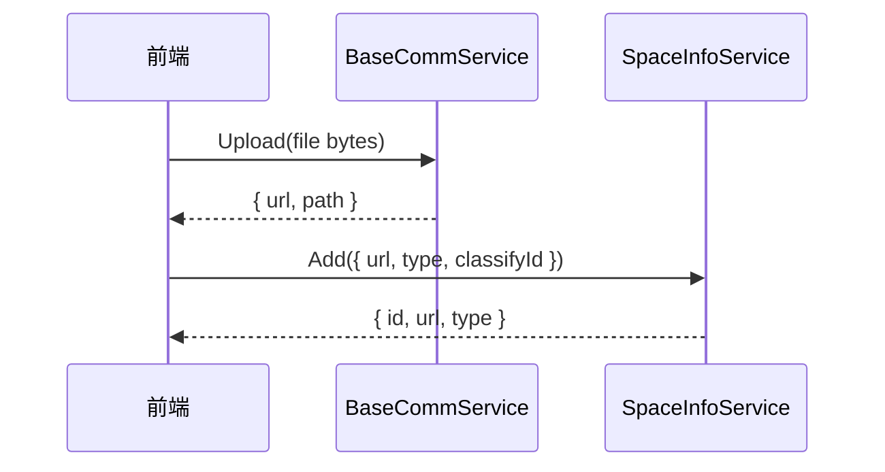

space 模块管理文件的**分类与索引**。实际上传走 `BaseCommService.Upload`，
成功后再调用 `SpaceInfoService.Add` 登记索引。

## 服务

| 服务 | RPC |
| --- | --- |
| `SpaceTypeService` | Add / Delete / Update / Info / List / Page |
| `SpaceInfoService` | Add / Delete / Update / Info / List / Page |

## 数据表

| 表名 | 字段 |
| --- | --- |
| `space_type` | name, parentId |
| `space_info` | url, type（image/video/audio/file）, classifyId |

## 使用流程



<Note>
  删除 space_info 只删除**索引**，物理文件保留（对齐 cool-admin-go）。
</Note>

## 查询过滤

按类型与分类过滤：

```bash
# 图片文件，分类 1
grpcurl -H "$H" -d '{"type":"image","classifyId":1,"page":1,"size":20}' \
  localhost:8001 space.v1.SpaceInfoService/Page
```

## 分类管理

```bash
# 新增分类
grpcurl -H "$H" -d '{"name":"默认分类","parentId":0}' \
  localhost:8001 space.v1.SpaceTypeService/Add

# 新增文件索引
grpcurl -H "$H" -d '{
  "url":"http://127.0.0.1:8002/public/uploads/20260101/a.png",
  "type":"image",
  "classifyId":1
}' localhost:8001 space.v1.SpaceInfoService/Add
```

<Warning>
  space 模块**不存储 userId 归属**（对齐 Go 版），访问控制完全依赖 RBAC 权限。
</Warning>
