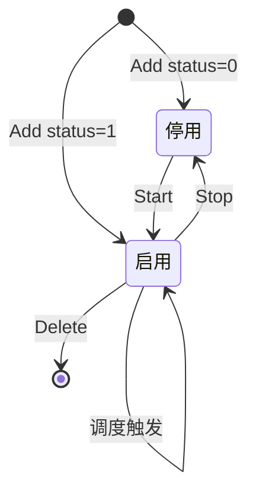

task 模块提供完整的定时任务能力，支持 cron 表达式、固定间隔、手动触发与日志审计。

## 服务

| 服务 | RPC |
| --- | --- |
| `TaskInfoService` | Add / Delete / Update / Info / List / Page / **Start / Stop / Once / Log** |

## 数据表

| 表名 | 说明 |
| --- | --- |
| `task_info` | 任务定义（cron / service / status / startDate 等） |
| `task_log` | 执行日志（成功保留 20 条，失败全留） |

## cron 表达式

| 格式 | 示例 | 说明 |
| --- | --- | --- |
| 6 段（秒分时日月周） | `1 2 3 * * *` | 与 Go robfig/cron 对齐 |
| `@every` | `@every 5s` / `@every 2m` | 固定间隔 |
| 描述符 | `@hourly` / `@daily` / `@yearly` | 常用周期 |

<Note>
  间隔型任务（`taskType=1`）直接用毫秒字段 `every`，支持 &lt;1s 精度（修正 Go 版 `@every 0s` 问题）。
</Note>

## 生命周期



<AccordionGroup>
  <Accordion title="Add with status=1">
    自动集群广播 `TaskAddTask(id)`，所有节点加载调度。
  </Accordion>
  <Accordion title="Update">
    `status=1` → `TaskStartFunc`；`status=0` → `TaskStopFunc`。
  </Accordion>
  <Accordion title="Delete">
    先 `TaskStopFunc` 停调度，再软删。
  </Accordion>
  <Accordion title="Once">
    立即执行一次 `service` 字段指定的函数。
  </Accordion>
</AccordionGroup>

## 函数串（service）

任务通过 `service` 字段调用分布式函数，格式 `Name(param)`：

| 内置函数 | 说明 |
| --- | --- |
| `TaskStartFunc(id)` | 启用任务 |
| `TaskStopFunc(id)` | 停用任务 |
| `TaskAddTask(id)` | 加载进调度器 |
| `TaskTest(param)` | 演示函数 |
| `BaseFuncClearLog(all)` | 清理过期操作日志 |

## 使用示例

```bash
# 新增 5 秒间隔任务
grpcurl -H "$H" -d '{
  "name":"心跳","cron":"@every 5s",
  "service":"TaskTest(heartbeat)","status":1
}' localhost:8001 task.v1.TaskInfoService/Add

# 立即执行一次
grpcurl -H "$H" -d '{"id":8}' localhost:8001 task.v1.TaskInfoService/Once

# 查询日志
grpcurl -H "$H" -d '{"page":1,"size":10}' \
  localhost:8001 task.v1.TaskInfoService/Log
```

## 分布式函数

任务生命周期通过 `cluster_run_func` 广播（Redis pub/sub `cool:func`），
调度触发用 `run_func` 本地执行：

| 函数属性 | 行为 |
| --- | --- |
| `is_all_worker=true` | 所有节点执行（默认） |
| `is_all_worker=false` | 仅主节点执行（master 选举 `cool:masterflag`） |
| `is_singleton=true` | 调度器内防重叠（AtomicBool） |

```bash
# 通过 Redis 直接触发函数
docker exec cool-redis redis-cli PUBLISH cool:func "TaskTest(hello)"
# → 服务日志: TaskTest executed param=hello
```

## 日志剪枝

成功日志每个任务仅保留最新 **20** 条；失败日志永不剪枝（便于排查）。
